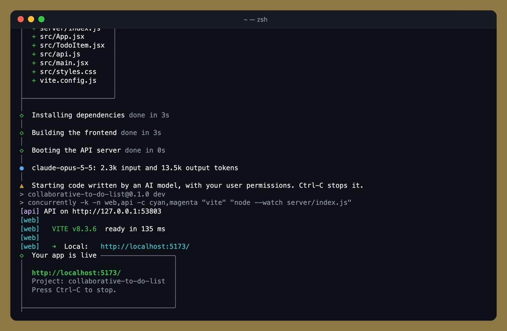
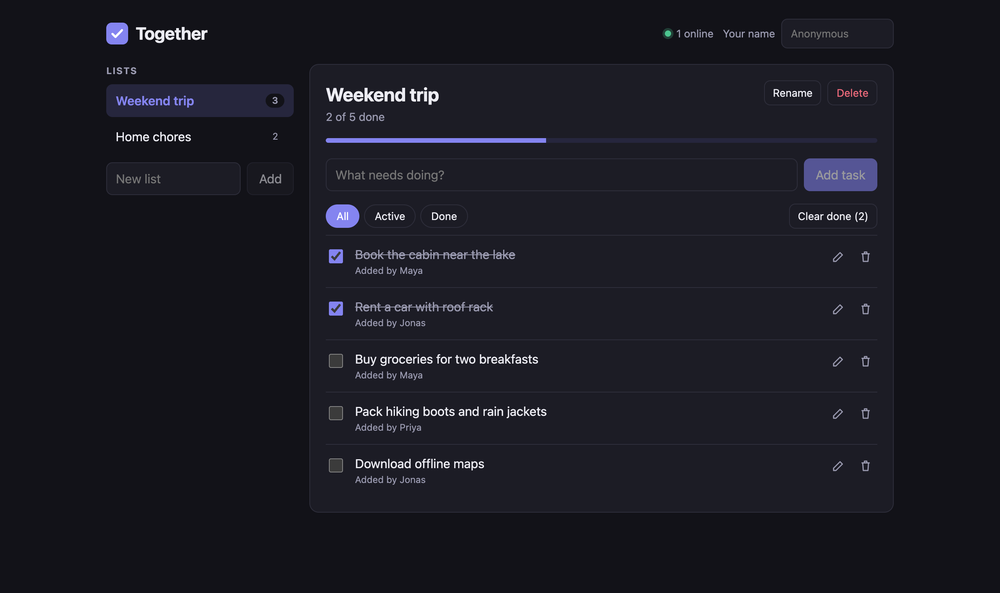
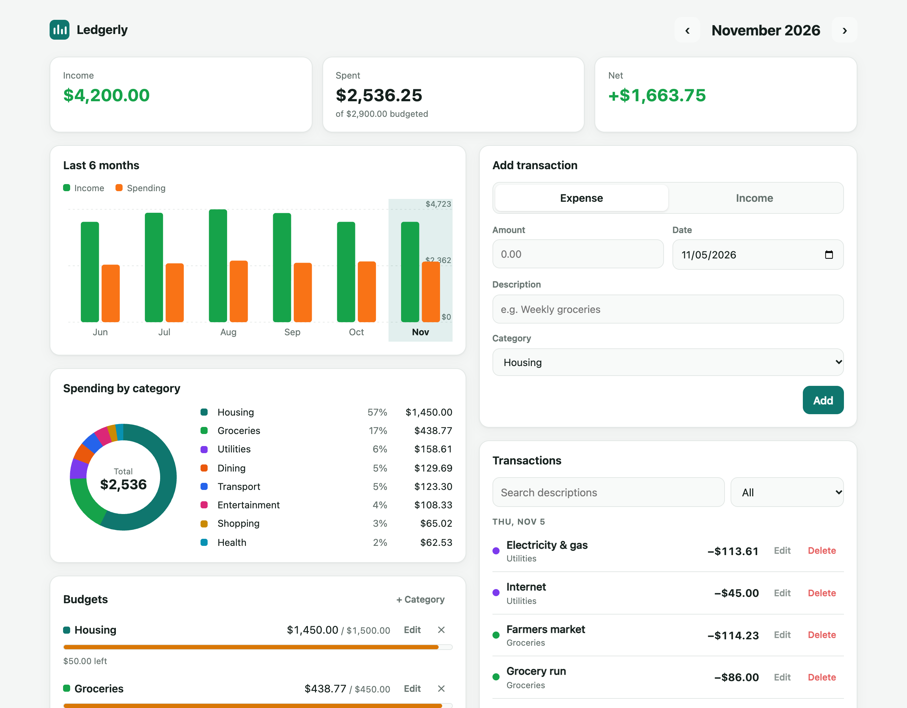
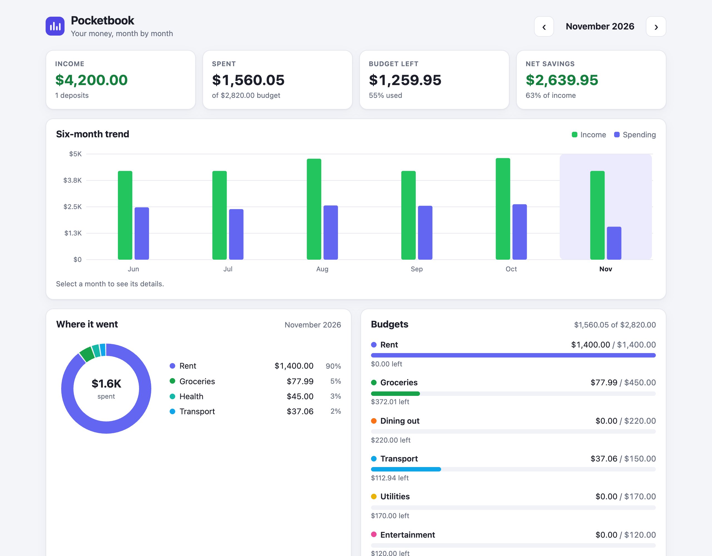
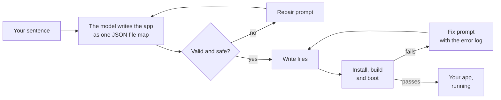

<div align="center">

# Ignite

### Type one sentence. Get a running full-stack app.

[](https://www.npmjs.com/package/ignite-ai)
[](https://github.com/VihaanSinghBroCode/ignite-ai/actions/workflows/ci.yml)
[](https://nodejs.org)
[](LICENSE)



<sub>Recreated from a real run on the default settings and sped up. Writing the app took 102 seconds.</sub>

</div>

## Quick start

```bash
export ANTHROPIC_API_KEY=sk-ant-...      # or OPENAI_API_KEY
npx ignite-ai "Build a collaborative to-do list"
```

A couple of minutes later the app is running at `http://localhost:5173`, and the project folder is yours to edit, commit and deploy. If no key is set, Ignite asks for one and uses it for that run only.

Requires Node 22.12 or newer.

## What it built

Two real apps from two sentences, on the default settings. Nothing was edited afterwards.

<table>
  <tr>
    <td width="50%"></td>
    <td width="50%"></td>
  </tr>
  <tr>
    <td><code>"Build a collaborative to-do list"</code><br><sub>1m50s · 13.5k output tokens · $0.27</sub></td>
    <td><code>"A personal budget tracker with monthly spending charts"</code><br><sub>2m37s · 20.7k output tokens · $0.42</sub></td>
  </tr>
</table>

<sub>Times are from typing the command to a running app. Costs are at Anthropic API prices for `claude-opus-5-5`.</sub>

<details>
<summary>The same budget prompt with <code>--effort medium</code></summary>
<br>

<sub>6m28s · 49.8k output tokens · $1.01. Bigger and more polished, at about three times the time and cost.</sub>
</details>

## What you get

- **A real full-stack project:** a React 19 and Vite frontend with an Express 5 API, in a folder you own.
- **Live collaboration when the idea calls for it:** changes sync between browser tabs over WebSockets.
- **Data that persists:** saved to JSON files on disk, with no database to set up.
- **Ready to show:** light and dark themes, layouts that work on phones, and realistic sample data on first load.
- **No setup:** generated apps run offline, with no accounts, API keys or environment variables.

## How it works



**One JSON object, checked strictly.** The model returns a single object that maps file paths to file contents. Structured outputs can't describe an object whose keys are file paths, so the system prompt states the contract and Ignite verifies the result. Output that fails a check goes back to the model along with the reason.

**Checked before you see it.** Ignite installs dependencies, builds the frontend and boots the server. If a step fails, the error log goes back to the model for up to two fix rounds.

**Resilient to API trouble.** Rate limits and dropped streams are retried with backoff, honoring `Retry-After`, and every wait is shown in the terminal. A bad key, an unknown model or an empty balance stops the run immediately with a clear message.

## Speed and cost

Measured with the default model, `claude-opus-5-5`:

| Effort | Time to a running app | Output tokens | Cost per app |
| --- | --- | --- | --- |
| `low` (default) | 1m50s – 2m37s | 13.5k – 20.7k | $0.27 – $0.42 |
| `medium` | 6m28s – 6m38s | 49.8k – 52.4k | $1.01 – $1.07 |

Your API account pays for each run, and Ignite prints the token count at the end. With `--effort medium` or higher, also pass `--max-tokens 128000`: `medium` came within about 12k tokens of the 64k default limit.

## Options

```
ignite-ai [prompt...]

-p, --provider <name>   anthropic or openai (default: whichever key is set)
-m, --model <id>        model id (default: claude-opus-5-5 or gpt-6-astra)
-e, --effort <level>    low, medium, high, xhigh or max (default: low)
--max-tokens <n>        output limit for each model response (default: 64000)
--max-fixes <n>         automatic fix rounds when a check fails (default: 2)
-d, --dir <path>        project directory (default: derived from the prompt)
--force                 write into a non-empty --dir, overwriting same-named files
--no-install            write the files and stop
--no-start              install and check, but do not start the dev server
--open                  open the app in your browser when it is ready
```

`IGNITE_PROVIDER` and `IGNITE_MODEL` set the provider and model from the environment. `ANTHROPIC_BASE_URL` and `OPENAI_BASE_URL` point the SDKs at a gateway.

Install it globally to get a shorter command:

```bash
npm install -g ignite-ai
ignite "A habit tracker with streaks"
```

## Safety

Ignite runs code written by an AI model, on your machine, with your user permissions. **It is not a sandbox.** Use a container or VM if that matters for your use.

What Ignite does to reduce the risk:

- **Paths:** rejects anything absolute or containing `..`, strips invisible Unicode characters, and refuses to write through symlinks.
- **Dropped files:** discards dotfiles such as `.npmrc`, `.git/hooks` and `.vscode/tasks.json`, plus lockfiles and `node_modules`.
- **`package.json`:** rebuilds it from an allowlist. The model's scripts, `overrides`, `bin` and `workspaces` never run.
- **Dependencies:** installs with `--ignore-scripts` from the npm registry only, and checks that every extra package exists before installing it.
- **Environment:** hides variables that look like credentials (`*KEY*`, `*TOKEN*`, `*SECRET*` and similar) from npm and the generated app.

The checks catch broken imports, syntax errors and servers that crash at startup. They don't click through the UI, so an app can pass and still have small bugs. Treat the result as a strong first draft.

## FAQ

<details>
<summary><b>Which models does it support?</b></summary>
<br>
Any Anthropic or OpenAI model you have access to, via <code>--model</code>. The defaults are <code>claude-opus-5-5</code> and <code>gpt-6-astra</code>. For a faster, cheaper run, <code>--model claude-sonnet-5-5</code> built a working app in about 2.5 minutes in testing. OpenAI support has so far been tested only against a simulated API.
</details>

<details>
<summary><b>What happens if the generated app doesn't work?</b></summary>
<br>
Ignite sends the failure log back to the model for up to two fix rounds (<code>--max-fixes</code>). If it still fails, the files stay on disk and the last error is printed, so you can fix it yourself or run Ignite again.
</details>

<details>
<summary><b>Where does my API key go?</b></summary>
<br>
Only to your provider's API. Ignite never writes it to disk and hides it from the generated app's environment. A key typed at the prompt lasts for that run only.
</details>

<details>
<summary><b>Why is the package called <code>ignite-ai</code>?</b></summary>
<br>
The names <code>ignite</code> and <code>genesis</code> already belong to other packages on npm, so <code>npx ignite</code> would run someone else's tool.
</details>

## Contributing

Bug reports, ideas and pull requests are welcome. [CONTRIBUTING.md](CONTRIBUTING.md) covers setup, the test suites and how the code is organized. Please report security issues privately, as [SECURITY.md](SECURITY.md) describes.

## License

[MIT](LICENSE)
